<p align="center">
  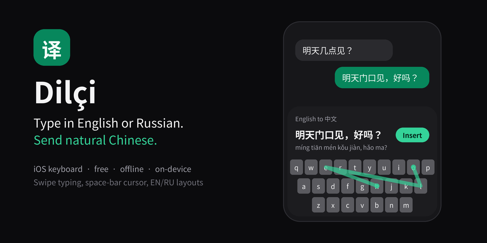
</p>

<p align="center">
  <a href="https://github.com/Kerim-Myratlyev/dilci/actions/workflows/ci.yml"></a>
  
  
  
  
  <a href="LICENSE"></a>
</p>

<h3 align="center">An iPhone keyboard that turns your English or Russian into the Chinese a local would actually type.</h3>
<p align="center">Free · Offline · No account · No API key</p>

<p align="center">
  <picture>
    <source media="(prefers-color-scheme: dark)" srcset="docs/showcase-dark.png">
    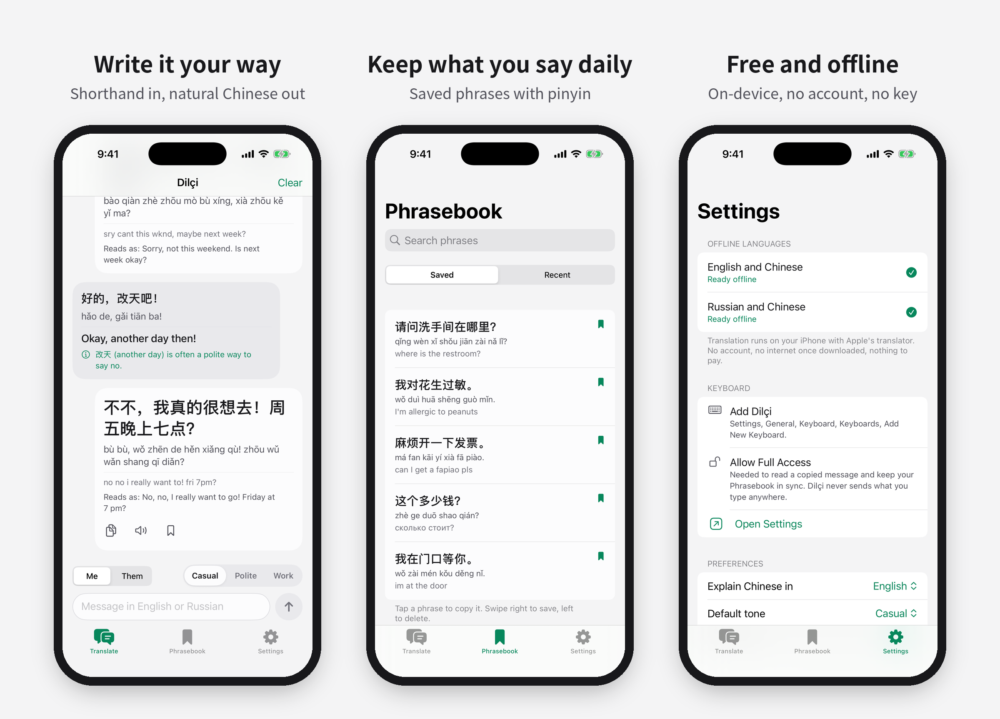
  </picture>
</p>

## Why

Living in China means every WeChat conversation goes like this: write the message, switch to a translator, paste, copy, switch back, paste, and hope it doesn't sound like a textbook.

**Dilçi** (Turkmen for *linguist*) does it inside the keyboard:

1. Type the way you text, shorthand and all: `see u tmrw at the gate ok?`
2. Switch to the Dilçi keyboard. The Chinese and its pinyin are already there.
3. Tap **Insert** and send.

| You type | Dilçi writes |
|---|---|
| `see u tmrw at the gate, ok?` | 明天门口见，好吗？ |
| `can u send me the address pls` | 你能把地址发给我吗？ |
| `щас буду, 5 мин` | 马上到，五分钟 |

<sub>Examples show the intended output. Wording comes from Apple's on-device translator and can vary slightly.</sub>

## Features

<table>
<tr>
<td width="50%" valign="top">

**Translation that understands chat**
- Expands 170+ English and Russian shorthands (`u`, `tmrw`, `pls`, `wru`, `спс`, `щас`, `мб`)
- Three tones: **Casual**, **Polite** (uses 您), **Work**
- **Their message**: copy what they sent, get it explained, and reply in context
- **Reads as**: every translation is translated back so you can check it
- Culture notes for 改天, 呵呵, 再说吧, 辛苦了 and more
- Uses Apple Intelligence when your iPhone has it

</td>
<td width="50%" valign="top">

**A keyboard that feels native**
- UIKit keys with hand-tracked touches: light and fast, with multi-finger rollover
- **Swipe typing** in English (30k words) and Russian (40k words)
- **Space-bar trackpad** to move the cursor
- English and Russian layouts, key previews, hold Delete for words, hold е for ё
- System key clicks and haptics

</td>
</tr>
</table>

## Screens

<table>
<tr>
<th>Translate</th><th>Phrasebook</th><th>Settings</th><th>Welcome</th>
</tr>
<tr>
<td>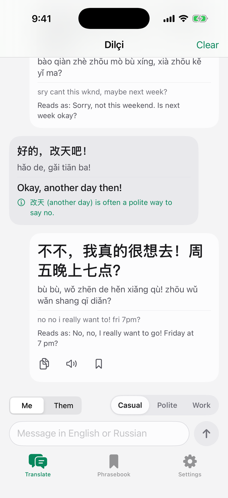</td>
<td>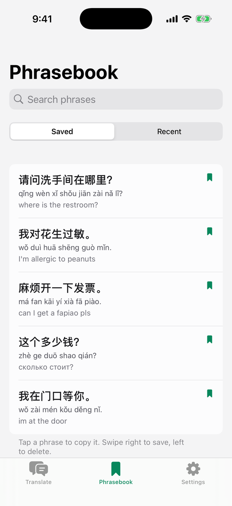</td>
<td>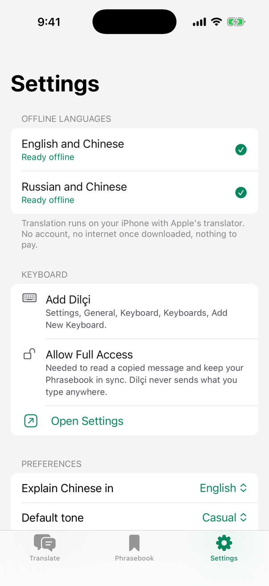</td>
<td>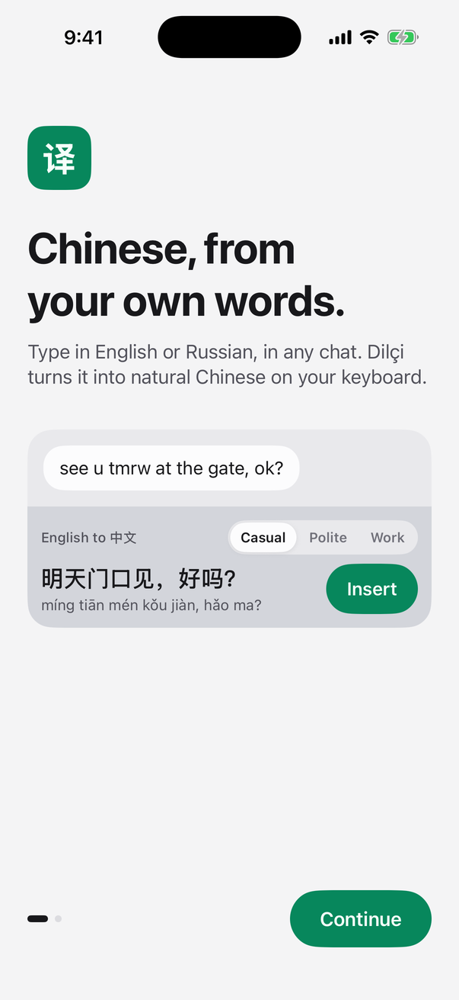</td>
</tr>
<tr>
<td>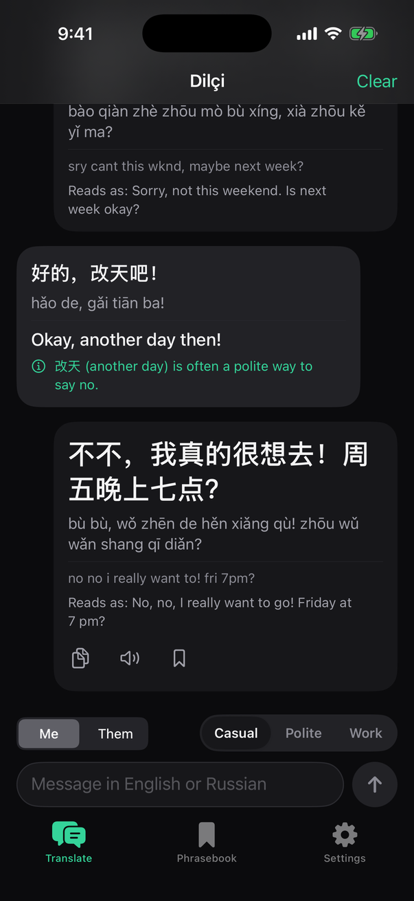</td>
<td>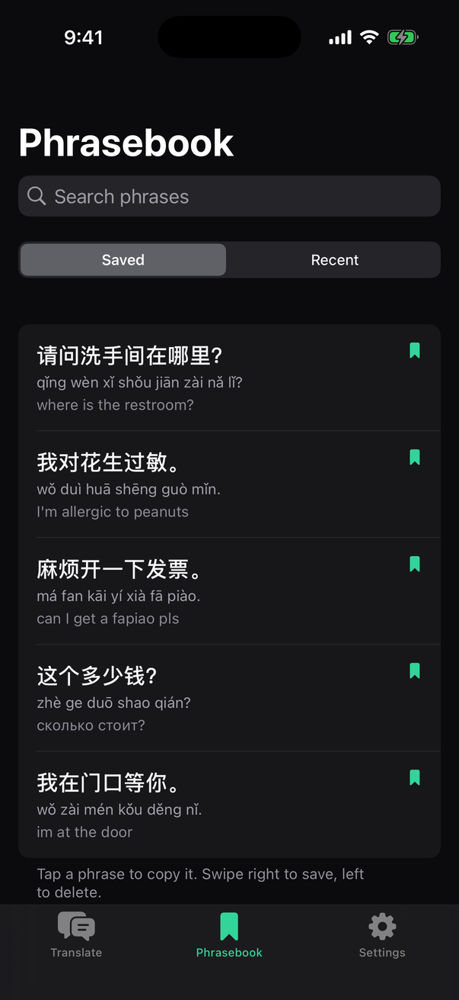</td>
<td>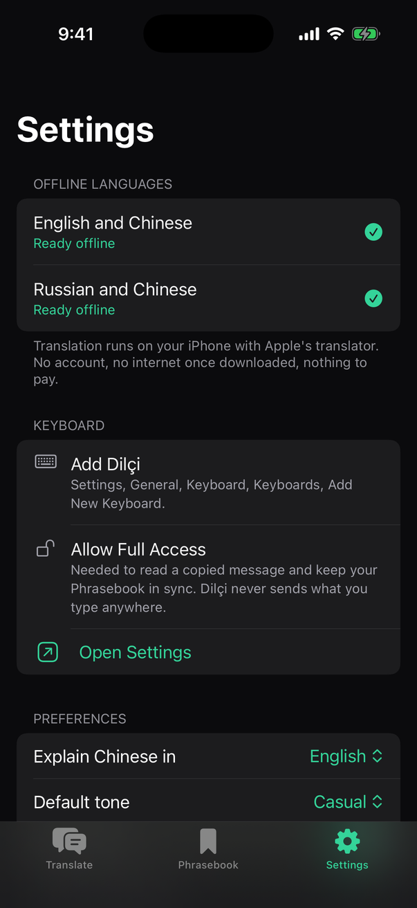</td>
<td>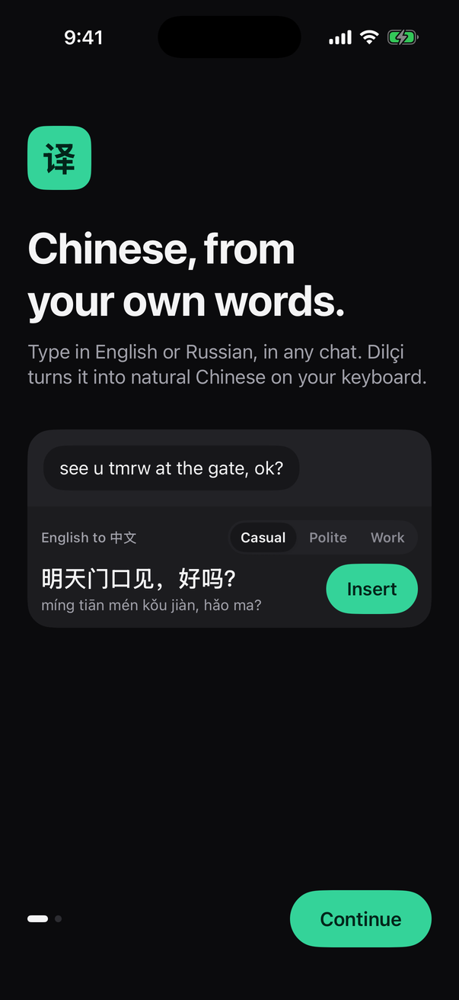</td>
</tr>
</table>

<sub>Real screenshots from the iOS Simulator, captured automatically by the <a href=".github/workflows/screenshots.yml">Screenshots workflow</a> using built-in sample conversations.</sub>

## How it works

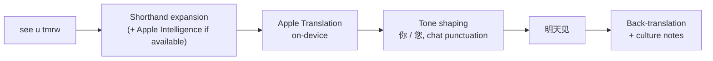

Everything runs on the iPhone. Apple's translation models download once inside the app, then work with no connection, which matters in China, where many online translators are blocked or slow.

Swipe typing uses a small decoder ([`SwipeDecoder.swift`](Keyboard/SwipeDecoder.swift)). It keeps words whose letters the path passes in order, then ranks them by how closely the path matches each word's ideal line (dynamic time warping) plus word frequency. On simulated noisy swipes it picks the right word first about 9 times in 10.

## Install

You need **Xcode 16+** and an iPhone on **iOS 18+**.

1. Clone the repo and open `Dilci.xcodeproj`.
2. For the **Dilci** and **DilciKeyboard** targets, choose your team under *Signing & Capabilities*.
3. If the bundle ID is taken, change `DILCI_ID` in Build Settings (e.g. `com.yourname.dilci`).
4. Run on your iPhone and tap **Get** to download Chinese.
5. **Settings › General › Keyboard › Keyboards › Add New Keyboard › Dilçi**, then turn on **Allow Full Access**.

> On a free Apple ID, Xcode may refuse App Groups. Translation still works; only the phrasebook sync between keyboard and app needs them.

## Project layout

```
App/        Conversation, Phrasebook, Settings, onboarding (SwiftUI)
Keyboard/   UIKit key grid, swipe decoder + word lists, translation strip
Shared/     Translation pipeline, Apple Translation bridge, slang, culture notes, theme
Tests/      Unit tests for the core (swift test)
Config/     Info.plists and entitlements
```

`swift test` runs the core tests. CI builds the app and keyboard for the simulator on every push.

## Roadmap

- [ ] Demo video of swipe typing to Chinese
- [ ] Turkmen as a source language
- [ ] Next-word suggestions
- [ ] iPad layout
- [ ] TestFlight build

## Contributing

Good first contributions:
- **Shorthand**: add pairs to [`Shared/Slang.swift`](Shared/Slang.swift)
- **Culture notes**: add phrases to [`Shared/CultureNotes.swift`](Shared/CultureNotes.swift), in English and Russian
- **Bugs**: open an issue with your iOS version, the app you typed in, and what you typed

See [CONTRIBUTING.md](CONTRIBUTING.md).

## Privacy

No server, no analytics, no account. Text is translated on your iPhone by Apple's frameworks. Full Access is used only for haptics, reading the clipboard when you tap **Their message**, and sharing the phrasebook between keyboard and app.

## License

[MIT](LICENSE) © Kerim Myratlyev

<p align="center"><sub>If Dilçi helps you talk to someone, give it a ⭐ so others in China can find it.</sub></p>
